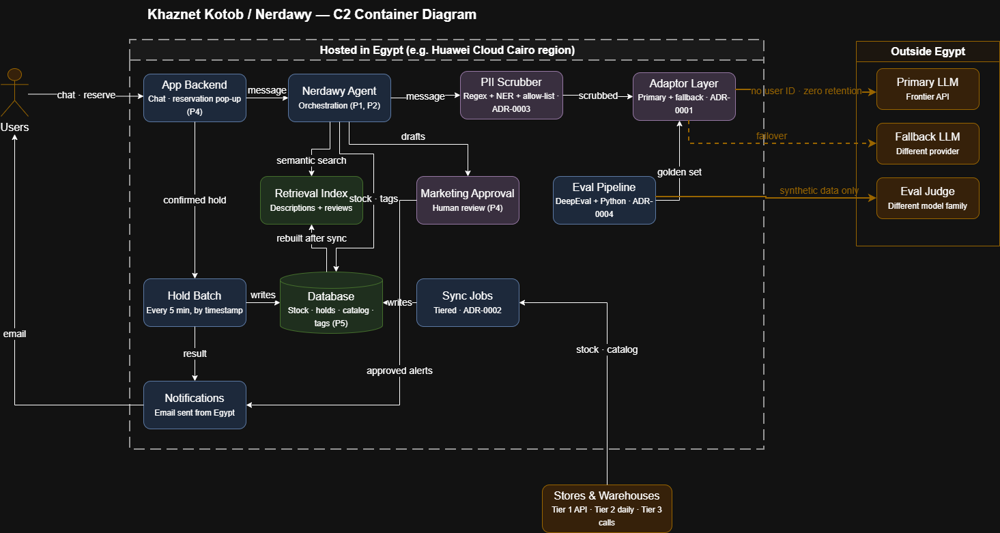

# Governance Pack — Khaznet Kotob / Nerdawy

> Status: **Draft**

## 1. System in scope

**Khaznet Kotob** is an Egyptian book-broker platform that aggregates stock from bookstores and warehouses, so users can find any book, order delivery, or locate the nearest physical copy.

**Nerdawy** is the platform's bilingual (Egyptian Arabic / English) AI chat agent. It replies in English, Arabic, or a mix of both, matching how the user talks to it. It helps users in three ways:

1. **Search and order**
    - Searching for specific books.
    - Reserving shortlisted books for pickup.
    - Ordering from a distant bookstore, or requesting a book if none is available.
2. **Checking compatibility**
    - Checking reviews from trusted sites stored in the platform's database, and platform users' own reviews.
    - Checking whether a requested book matches the user's history preferences.
    - Drawing out the user's current preferred theme and recommending books connected to it.
3. **Recommendations and alerts**
    - Recommending new books likely to interest the user, based on collected information.
    - Alerting the user when a previously unavailable book becomes available, and pre-booking it for a set time until they decide to buy or discard it.

This pack governs **Nerdawy and the AI layer around it**. Other platform parts (catalog, inventory, orders, maps) appear only where they interact with Nerdawy or user data.

## 2. Business goals

| ID | Goal | Measured by |
|----|------|-------------|
| G1 | **Trust** — users trust Nerdawy's answers and trust us with their data | Grounding (faithfulness) ≥ 95% |
| G2 | **Engagement** — users don't abandon the chat | Time to first token p50 < 1s, p95 < 5s |
| G3 | **Helpfulness** — users get real help finding books | Answer relevance ≥ 90% |
| G4 | **Revenue** — the chat drives sales | Nerdawy users reserve 10% more books than non-users |

## 3. Architecture principles

**P1 — Grounded, fresh, or silent** *(G1)*
Nerdawy answers only from platform data (catalog, inventory, reviews); if nothing relevant is found, it says it doesn't know. Stock is shown with its "last updated" time, and treated as stale past its store tier's threshold: 5 minutes for API stores, one day for daily-upload stores; stores with no system are never shown as confirmed (ADR-0002).
*Verified by:* faithfulness ≥ 95% on each of the English, Arabic and mixed-language golden subsets (ADR-0004).

**P2 — Answer the question asked** *(G3)*
Every reply addresses the user's request and ends with a useful next step (a listing, nearest copy, or reservation).
*Verified by:* answer relevance ≥ 90%; "I don't know" on ≤ 20% of answerable questions at launch, tightening over time. The cap is set at the operating point where faithfulness (P1) stays ≥ 95%, and reviewed quarterly.

**P3 — Fast, reachable, and affordable** *(G2)*
Responses stream. On failure, requests route to a second LLM from a different provider, with short timeouts. If both fail, the user sees a clear "Nerdawy is unavailable" message. Both models pass the same evals. Each conversation stays under **X EGP**.
*Verified by:* time to first token p50 < 1s and p95 < 5s; 99.9% availability of full AI answers; cost per conversation.
*Open:* X is set by ADR-0001.

**P4 — User first, then sales** *(G4)*
Nerdawy recommends what fits the request, never pushing stock or margin over relevance. Nerdawy never books on its own: every reservation is confirmed by the user through a reservation pop-up. The only exception is marketing temporary pre-reservations, which are held for a limited time and capped at a set number per day. Marketing campaigns and alert templates are approved by a human before sending.
*Verified by:* users randomly shown Nerdawy reserve 10% more books than users not shown it, with P2 relevance holding steady.

**P5 — Personal data handled per PDPL** *(G1)*
Personal data is stored in Egypt, with informed consent, a stated purpose, and limited retention (Law No. 151/2020 and its Executive Regulations). External AI providers receive only the live conversation, PII-scrubbed and without user IDs, under zero data retention, a cross-border transfer permit, and the contract-performance exception. Preferences are computed locally from structured history, and past chats are kept as preference tags. Full transcripts are kept only from users who consented to quality review, stored in Egypt until curated into the golden dataset (ADR-0004). Marketing alerts go only to opted-in users under a direct-marketing permit.
*Verified by:* ARB privacy review; CI check against the approved-provider list.
*Residual risk:* PII scrubbing is imperfect, especially for Arabic; addressed in ADR-0003.

## 4. Architecture decisions

Full records live in `adr/`.

| ADR | Decision | Trade-off accepted | Serves | Status |
|-----|----------|--------------------|--------|--------|
| [0001 LLM hosting](../adr/0001-llm-hosting-and-routing.md) | External API via adaptor layer, primary + fallback (vs. self-hosted, direct API) | Per-use cost and scrubber risk, for frontier Arabic quality and no upfront cost | P1, P2, P3, P5 | Accepted |
| [0002 Database sync](../adr/0002-database-sync.md) | Tiered by data type and store capability: stock every 5 min for API stores, 5-min hold batches by timestamp, weekly catalog and reviews (vs. batch all, real-time all) | Pending reservations and slower paths for low-tier stores, for fresh data where stores can support it | P1, P4 | Accepted |
| [0003 PII scrubbing](../adr/0003-pii-scrubbing-method.md) | Regex + NER + catalog allow-list (vs. regex only, NER only, local LLM) | Some mixed-language PII may slip through, for CPU-only, low-latency scrubbing in Egypt | P1, P2, P3, P5 | Accepted |
| [0004 Evaluation](../adr/0004-evaluation-method.md) | DeepEval + pure Python (vs. either alone) | Two eval paths to maintain, for standard metrics plus scrubber-specific ones | P1, P2, P3, P5 | Accepted |

## 5. ARB checklist
 
A design is reviewed against this checklist before launch, and again whenever a provider, model version, prompt, data source, or Nerdawy action changes. Every item must be answered yes, or carry a named owner and date.
 
| Area | Checks |
|------|--------|
| **Security** | • LLM calls only via the adaptor (ADR-0001) • Prompt-injection samples pass (ADR-0004) • Reservations need user pop-up; pre-reservations capped (P4) • Keys in a secrets manager; rate limits; no PII in logs |
| **Privacy (PDPL)** | • Data stored in Egypt, with consent and notice (P5) • Purpose and retention per data category (P5) • Cross-border and marketing permits; zero-retention providers (P5) • Requests scrubbed, no user IDs (ADR-0003) |
| **Evals** | • Faithfulness ≥ 95%, relevance ≥ 90% per language (P1, P2) • Both providers pass; judge from another family (P3, ADR-0004) • Scrubber meets its targets (ADR-0003) • Load tests meet TTFT; failover tested (P3) |
| **Cost** | • Cost per conversation under cap, with alerts (P3) • Spend tracked against self-hosting break-even (ADR-0001) |
| **Human oversight** | • Campaigns and alert templates human-approved (P4) • Golden-set curation by Arabic-fluent reviewers (ADR-0004) • Users can reach a human |

## Diagram

